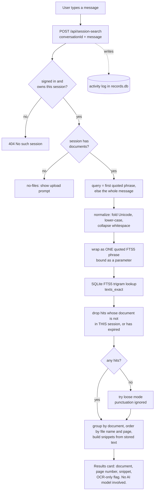

# How Locus works

A walkthrough of the code for a technical reader: where uploaded files go, how a PDF becomes
searchable, how a search runs, and where (and whether) a model is involved. Every step names the
file and function that does it, so you can open the code beside this page.

Paths are relative to the project root. "Index" means the SQLite search database
(`data/index/search.db`).

---

## 1. The short version

- Locus is a **PDF search tool**. You give it PDFs; it reads their text (running OCR on scanned
  pages) and stores that text in a SQLite full-text index. A search looks the words up in that index
  and shows the document, the page number and a snippet.
- **Search uses no AI model.** It is a database lookup. Page numbers and snippets come from rows the
  indexer wrote, so they cannot be invented. (Section 7.)
- A language model (Qwen3 4B through LM Studio) exists only as an **optional chat mode, switched off**.
  Even when on, it is not given the matching pages. (Section 8.)
- Everything runs on one laptop: one Next.js server, SQLite files, and the command-line tools
  `poppler` and `tesseract`. Nothing is sent to a cloud service to read or search a document.

---

## 2. The big picture: browser to laptop

```
Browser ──► https://local-chat-one-ivory.vercel.app ──307──► https://<random>.trycloudflare.com ──tunnel──► localhost:3000 (Next.js, on the laptop)
            (Vercel: tiny redirect app)                      (Cloudflare quick tunnel)                      (next start)
```

| Hop | What it is | Code |
|---|---|---|
| Vercel link | A tiny standalone app that answers every request with a redirect to the current tunnel address. It checks the tunnel is up first and otherwise shows an "offline" page. It holds no documents and no data. | `redirect/api/redirect.js`, `redirect/vercel.json` |
| Cloudflare tunnel | `cloudflared` opens an outbound connection from the laptop to Cloudflare and gets a random `*.trycloudflare.com` address. The address **changes every time the tunnel restarts**; that is why the Vercel link exists. | started by `scripts/share.ts` |
| Next.js server | `next start` on port 3000: the pages, the API routes, the login check. | `src/app/**`, `src/proxy.ts` |
| Laptop disk | Uploaded PDFs, the search index, the accounts database, the OCR cache. | `data/` (git-ignored) |

`npm run share` (`scripts/share.ts`) does all of it: builds the app, starts `next start` with
`NODE_ENV=production` and `LOCUS_ENABLE_UPLOADS=true`, starts the indexer worker (only when the library
and admin area are set up), starts the tunnel, updates the Vercel redirect, then checks every 60 s
that the tunnel still answers. It also generates `SESSION_SECRET` into `.env.local` if missing.

Every page and API route sits behind `src/proxy.ts`: no valid session cookie means a redirect to
`/login` (pages) or a 401 (APIs). Only `/login`, `/api/login`, `/api/logout` and, in accounts mode,
`/api/signup` are open.

Because the browser talks to the laptop through the tunnel, the laptop must be awake and
`npm run share` running for the link to work.

---

## 3. Upload flow ("Choose folder" and single-file upload)

### 3.1 In the browser

"Choose folder" (`src/components/FolderPicker.tsx`) uses a hidden `<input webkitdirectory>`. The
browser hands over every file inside the chosen folder; nothing has left the machine yet.

1. `readPick()` (`src/lib/folderScope.ts`) keeps the PDFs and skips everything else.
2. `sha256Hex()` computes each file's SHA-256 **in the browser** (`crypto.subtle.digest`).
3. `planFolder()` sends `{ name, files: [{ path, size, sha256 }] }` to **`POST /api/folders`**. No file
   contents yet, only names, sizes and hashes.
4. The server answers with the list of paths that still need uploading (files already indexed with
   the same hash are skipped), or an error such as "over your upload limit".
5. `uploadFile()` (`src/lib/uploadsClient.ts`) sends each needed file as `multipart/form-data` to
   **`POST /api/uploads`** with fields `conversationId`, `file` and `path`. Several go at once
   (`LOCUS_UPLOAD_PARALLEL`, default 4, max 8). A failed send is retried up to 3 times with backoff.
6. The response is a stream of Server-Sent Events: `uploading`, `reading`, `indexing`, `searchable`,
   `running-ocr`, `ready` (or `error`). The UI turns these into the progress line.

A single file attached in a normal session goes through the same `POST /api/uploads`.

### 3.2 On the server

**`POST /api/folders`** (`src/app/api/folders/route.ts`) works out which session the folder belongs to:

- `folderSessionId(userId, folderName)` (`src/lib/uploads/folders.ts`) is an HMAC-SHA256 keyed with
  `SESSION_SECRET` over `userId + folder name`, prefixed `fld_`. The same account picking the same
  folder always lands on the same session (so nothing is uploaded twice), and nobody else can compute it.
- `authorizeConversation()` (`src/lib/session.ts`) makes the caller the owner of that session.
- Existing documents in the session whose hash no longer matches, or whose file has gone, are removed.
- The batch is checked against the limits below *before* anything is sent.

**`POST /api/uploads`** (`src/app/api/uploads/route.ts`), in order:

1. Uploads must be enabled (`uploadsEnabled()`, `src/lib/uploads/config.ts`).
2. `authorizeConversation()`: the signed-in user must own this session id.
3. `validateUploadBytes()` (`src/lib/uploads/validate.ts`): not empty, not over the size limit, and the
   content must **start with `%PDF-`**. The check is on the bytes, never on the file extension or the
   declared type, so a renamed `.exe` is refused.
4. Per-account limit (accounts mode): refuse if the account's bytes already used plus this file exceed
   `userUploadLimitBytes()`.
5. For a picked folder: if a file with the same path and hash is already in the session, answer with
   its current state instead of storing a second copy.
6. File-count limit: `maxFilesPerConversation()` (20) for a normal session, `maxFolderFiles()` (500)
   for a folder.
7. Total-storage cap: `measureStorageUsage()` (`src/lib/uploads/storage.ts`) measures the real size of
   the uploads folder plus the index folder; refuse if adding this file passes `storageCapBytes()`.
8. `indexUpload()` (`src/lib/uploads/pipeline.ts`) stores and reads the file (section 4).

### 3.3 Where the files are saved

- **Folder:** `data/uploads/` (override with `UPLOADS_DIR`). `uploadsDir()` in `src/lib/uploads/config.ts`.
- **Name:** `<sha256 of the content>.pdf`. `storedPathFor()` in `src/lib/uploads/storage.ts`.
  The name the person gave the file is never used as a path.
- **This folder is shared by all accounts. It is not split per account.** Two accounts that upload
  byte-identical PDFs share one stored file. The per-account separation is in the databases, not in
  the folder layout (3.4). When a document is deleted, `deleteSingleUpload()` /
  `deleteConversationUploads()` (`pipeline.ts`) remove the stored file only if no other document, in
  any session, still points at the same hash (`sha256StillReferenced()`).

### 3.4 What goes into SQLite

Two databases:

**The search index, `data/index/search.db`** (`SEARCH_INDEX_PATH`). Schema in `src/lib/search/schema.ts`.
Written by `insertUploadedDocument()` / `upsertPageOcr()` in `scripts/indexer/store.ts`.

| Table | One row per | Notable columns |
|---|---|---|
| `documents` | PDF | `conversation_id` (the session it belongs to), `original_filename` (display name), `filename` (= `<sha>.pdf`), `sha256`, `size_bytes`, `page_count`, `status` (`ready`/`indexing`/`failed`), `uploaded_at`, `expires_at` |
| `pages` | physical page | `page_no`, `page_label`, `source` (`text`, `text+ocr`, `ocr`, `blank`, `failed`, `pending-ocr`), `ocr_reason`, `image_coverage` |
| `texts` | reading of a page (up to two: `layer`, `ocr`) | `body` (as shown), `search` (case-folded), `loose` (punctuation removed) |
| `texts_exact`, `texts_loose` | the full-text indexes over `search` / `loose` | FTS5, trigram tokenizer |

**The records database, `data/app/records.db`** (`LOCUS_APP_DB_PATH` / `LOCUS_APP_DIR`). Schema in
`src/lib/records/db.ts`.

| Table | Holds |
|---|---|
| `users` | username, role (`user`/`admin`), passcode hash, token version, last login, disabled flag |
| `conversation_owners` | session id → owning user |
| `uploads` | one record per upload: user, session, file name, size, sha256, page count, status (`ready`/`failed`/`deleted`), error |
| `activity` | the admin's log: who did what, when, from which IP; search text is included unless `LOCUS_LOG_QUERY_TEXT=false` |

### 3.5 Limits and checks

| Check | Setting | Default | Per what | Code |
|---|---|---|---|---|
| File type | (none) | PDF magic bytes `%PDF-` | each file | `validateUploadBytes` |
| Largest file | `MAX_UPLOAD_FILE_BYTES` | 100 MB | each file | `maxUploadFileBytes` |
| Largest file in a folder pick | (derived) | 90 MB (stays under the tunnel's ~100 MB body limit) | each file | `maxFolderFileBytes` |
| Files in a normal session | `MAX_FILES_PER_CONVERSATION` | 20 | session | `maxFilesPerConversation` |
| Files in a folder pick | `MAX_FOLDER_FILES` | 500 | folder | `maxFolderFiles` |
| **Upload limit per account** | `LOCUS_USER_UPLOAD_MB` | 1000 MB (live app: 5000) | account (sum of its ready uploads in `records.db`) | `userUploadLimitBytes` in `src/lib/users/mode.ts` |
| **Total storage cap** | `STORAGE_CAP_BYTES` | 5 GB (live app: 25 GB) | whole machine: uploads folder + index folder | `storageCapBytes`, `measureStorageUsage` |
| Retention | `LOCUS_RETENTION_DAYS` | off | document | `retentionMs`, `src/lib/uploads/cleanup.ts` |

Notes: the per-account limit applies in accounts mode only. The upload path has no free-disk check;
the library worker has its own (section 9).

### 3.6 Privacy between accounts

- A session id belongs to the first signed-in user to use it (`claimConversation()`,
  `src/lib/records/ownership.ts`). Anyone else asking for it gets "No such session", the same answer as
  for an id that does not exist, so ids cannot be probed (`authorizeConversation()`, `src/lib/session.ts`).
- Every route that takes a session id calls `authorizeConversation()` first.
- Uploaded documents are tied to their session through `documents.conversation_id`, and a search is
  restricted to that session (section 7.3).
- The session is looked up from the signed cookie on every request, so disabling an account takes
  effect at the next request.

---

## 4. Reading the PDF

`indexUpload()` in `src/lib/uploads/pipeline.ts` runs in two passes so a file is searchable quickly
and the slow OCR finishes afterwards.

### 4.1 Pass 1: text layer (fast)

1. `onStage("reading")`. The file's SHA-256 is computed; if `data/uploads/<sha>.pdf` does not exist it is written.
2. `extractDocument()` (`scripts/indexer/extract.ts`) with `skipOcr: true`. The command-line tools it runs are in `scripts/indexer/pdf.ts`:
   - `pdfinfo` → page count and page sizes
   - `readPageLabels()` (`scripts/indexer/labels.ts`, uses `pdfjs-dist`) → printed page labels such as `iv` or `A-3`, when the PDF defines them
   - `pdftotext` → the **text layer** of every page in one call (falls back to page by page)
   - `pdfimages -list` → how much of each page is covered by images
   - `pdftotext -bbox` → where every word sits (used to spot broken words)
3. `planPage()` (`scripts/indexer/classify.ts`) decides, page by page, whether OCR is needed (4.2).
4. `insertUploadedDocument()` (`scripts/indexer/store.ts`) writes the document, all its pages and the
   text-layer text in one transaction. Pages that need OCR are written as `source = 'pending-ocr'`.
5. `onStage("searchable")` fires if any page is pending. **From this moment the file shows up in
   search results** using its text layer, and the browser shows "Searchable now · improving N scanned pages".
   With no pending pages it goes straight to `ready`.

### 4.2 When OCR runs ("smart" mode)

Uploads use `OCR_PAGES=smart` (`loadUploadConfig()` in `scripts/indexer/config.ts`). A page is OCR'd only if
`planPage()` gives it a reason (`OcrReason`):

| Reason | Meaning |
|---|---|
| `no-text-layer` | fewer than `MIN_TEXT_CHARS` (30) characters of text: a scan or drawn lettering (checked first for blank, using `pdftoppm` at 50 DPI; a blank page is not OCR'd) |
| `image-coverage` | images cover ≥ 30% of the page (a typed header over a scanned annexure) |
| `suspect-text-layer` | the layer exists but looks like symbol soup (broken font map) |
| `letter-spaced-text` | words come out in pieces like `BH ARAT H EAVY`, so a phrase would not match |
| `text-outside-layer` | lettering is drawn on the page but is not in the text layer (ink check, `scripts/indexer/ink.ts`) |

Other pages keep their text layer and are not OCR'd; that is where most of the time saving comes from.
`OCR_PAGES=all` restores OCR on every page. Measurements are in `docs/faster-uploads.md`.

### 4.3 Pass 2: OCR (background)

For each pending page, `ocrPage()` (`scripts/indexer/extract.ts`):

1. Looks in the **OCR cache** first (`scripts/indexer/ocrCache.ts`, `data/index/ocr-cache.db`), keyed by file hash + page + language + DPI. A page OCR'd before is not OCR'd again (re-uploading the same file is fast). Deleting the last document that uses a file also deletes its cache entries (`deleteSingleUpload()`).
2. Otherwise renders the page with `pdftoppm` (greyscale, 300 DPI by default) and runs `tesseract`.
3. **English first, Hindi on demand:** the first reading uses `eng`. If the page's text layer contains Devanagari, or ≥ 5% of recognised words came out under 60% confidence (`needsHindiReading()` in `classify.ts`), the page is read again with `eng+hin`. Only those pages pay the extra 30-55%.
4. Work is shared by one limiter sized to the CPU count (`OCR_CONCURRENCY`) and run at a lowered priority (`OCR_NICE`, default 10) so the laptop stays usable. Text extraction for other files is queued ahead of OCR.
5. `upsertPageOcr()` writes the result and flips the page to `text+ocr` or `ocr`. A page that fails is stored as `failed` with the error, so a gap is visible rather than silent.
6. `onStage("running-ocr")` after each page; `onStage("ready")` when all are done.

### 4.4 How a page becomes searchable rows

For each reading (`layer`, `ocr`) of a page, `store.ts` stores:

- `body`: the text after `normalizeText()` (`src/lib/search/normalize.ts`): Unicode folded (the `fi` ligature becomes `fi`), dash and quote variants unified, invisible characters removed, **all whitespace including line breaks collapsed to one space** (so a phrase broken across two lines still reads as one phrase);
- `search`: `foldCase(body)`, lower-cased;
- `loose`: `loosen(search)`, every character that is not a letter or digit replaced by a space.

`texts_exact` indexes `search` and `texts_loose` indexes `loose`, both as SQLite **FTS5 with the trigram
tokenizer** (every 3-character slice is indexed, so a query matches anywhere, mid-word included, like a
plain substring search but without reading every page). The FTS tables are contentless (they hold only
the index), which roughly halves the file size.

A text row's id is `pageId * 2 (+1 for OCR)` (`textId()` in `schema.ts`), so a match tells you its page
and which reading it came from without a join.

---

## 5. Folder pick: the same flow, with idempotence

Picking the same folder again sends only what changed: `/api/folders` compares each file's hash with
what is indexed, keeps the matches, deletes the stale ones and returns the rest. A dropped connection
can be retried safely because `/api/uploads` answers a re-sent file (same path + hash) with its current
state instead of adding a copy. Design notes: `docs/folder-pick.md`.

---

## 6. Search-only is the default mode

With `LOCUS_CHAT_ENABLED` off (`src/config/features.ts`, `isChatEnabled()`), every message typed in a
session is a search over that session's files. The browser calls **`POST /api/session-search`**, never `/api/chat`.

---

## 7. Search flow

### 7.1 Request

`src/app/api/session-search/route.ts`:

1. `authorizeConversation()`: only the session's owner.
2. `hasDocumentsForConversation()` (`src/lib/search/query.ts`): if the session has no live documents the answer is `no-files` (the UI shows the upload prompt).
3. `runDocumentSearch()` (`src/lib/chat/documentSearch.ts`):
   - the query is the first `"quoted phrase"` in the message if there is one, otherwise the whole message;
   - it runs **exact** mode, up to 50 hits;
   - if exact finds nothing, it also runs **loose** mode and offers the result as a one-click "without exact punctuation" alternative (never switched on automatically).
4. If the account has logging on (accounts mode), a row goes into `activity`.

The query is sent by `POST`, not `GET`, so it does not end up in URLs, history or access logs, and the
server never writes the query text to its own error log.

### 7.2 Exact and loose modes

| Mode | Compared as | Effect |
|---|---|---|
| exact | `foldCase(normalizeText(query))` against `texts.search` | case-insensitive; punctuation matters, so `26-2080` does **not** match `26/2080` |
| loose | `loosen(...)` against `texts.loose` | `26-2080`, `26/2080` and `26 2080` are the same query |

`prepareQuery()` in `query.ts` builds the compared form. `toFtsPhrase()` wraps it as **one quoted FTS5
phrase** with quotes doubled, so `AND`, `OR`, `NEAR`, `*` and column filters in the query are literal
text, and the phrase is bound as a parameter, never spliced into SQL.

### 7.3 The lookup

`search()` in `src/lib/search/query.ts`:

1. `SELECT rowid FROM texts_exact WHERE texts_exact MATCH ?` (or `texts_loose`). Queries shorter than 3 characters cannot use the trigram index, so they scan every page's text with `instr()` (`usedFullScan`): still exact, just slower.
2. Each matching row id is split into `pageId` and reading (`splitTextId`). An in-memory page map (`pageDoc`, `pageNo` arrays, reloaded when the index's `generation` counter changes) turns page ids into document and page number with no join.
3. **Privacy is enforced here:** `inScope(docId)` keeps a hit only if `map.scope.get(docId) === scope`, where `scope` is the session id passed in (`scope: conversationId`), and the document has not expired. Hits from other sessions never leave this function. Documents with `conversation_id NULL` (the standalone tender index) are reachable only with `scope: null`, via the admin-only `/api/search`.
4. Hits are grouped by document (ordered by file name, then page) and a window (`offset`/`limit`) of them is loaded.
5. For each hit, `buildSnippet()` (`src/lib/search/snippet.ts`) cuts a snippet out of the stored text with the match highlighted. The text layer is preferred over OCR for the snippet, and `ocrOnly` is set when only the OCR reading matched ("worth checking by eye").
6. Result: `{ documents: [{ docId, filename, hitCount }], hits: [{ filename, pageNo, pageLabel, source, matchedIn, ocrOnly, snippet }], totalPages, totalDocuments, hasMore, tookMs }`.

The filename is also matched (`filenameMatch`). There is no relevance ranking: results are in file-name then page order, deterministic.

"Show more" calls the same route with `offset` and `mode`, via `runDocumentSearchPage()`.

---

## 8. The model: search does not use one

**Search never touches an AI model.** `search()` is SQL over a text index. There is no embedding, no
semantic matching, no generated text anywhere in a result. `src/lib/search/query.ts` says so at the top, and
`src/app/api/search/route.ts` repeats it.

### The optional chat mode (off)

- Switch: `LOCUS_CHAT_ENABLED=true` and restart (`isChatEnabled()`, `src/config/features.ts`). Off now: the default in code is `false` and `.env.local` does not turn it on.
- With it **off**: `POST /api/chat` and `POST /api/title` answer 403 before reading the request body, so nothing reaches LM Studio or the URL fetcher. `scripts/share.ts` also skips the LM Studio check.
- With it **on**, `POST /api/chat` (`src/app/api/chat/route.ts`):
  1. runs the same document search first and streams the results card to the browser;
  2. optionally expands links in the user's message into page text (`src/lib/urlContext.ts`; only when `LOCAL_CHAT_ENABLE_URL_CONTEXT` is on, which `share.ts` sets only with chat);
  3. sends the conversation to the local model through `lmStudioClient()` (`src/lib/lmStudioClient.ts`): the OpenAI SDK pointed at `LM_STUDIO_BASE_URL` (default `http://localhost:1234/v1`), model `LM_STUDIO_MODEL` (default `qwen/qwen3-4b`), streaming the answer back.
- **What the prompt contains:** the conversation messages the browser sent (plus any fetched web-page text), and, when the session has documents, a system note (`DOCUMENT_SEARCH_SYSTEM_NOTE` in `documentSearch.ts`) that says, in effect: *results were computed from the index and shown in a separate card; you cannot read the uploaded files; do not state a document name, page number or any detail about their contents.*
- **The matching page text is not passed to the model.** The model never receives the search hits or the document text. Only the results card (built by `search()`) tells the user what the documents say. This is deliberate: a model describing documents it cannot read would be guesswork presented as fact.
- **Where requests go:** to whatever `LM_STUDIO_BASE_URL` says. `share.ts` forces `http://localhost:1234/v1` for the server it starts, so the model is always the one on the same laptop. There is **no `--allow-remote` flag in this code**: nothing here has a switch that permits a remote model. The only way a request leaves the machine is someone editing `LM_STUDIO_BASE_URL` to point elsewhere when running the server some other way, so keep that setting local.

---

## 9. My folders / Sources (the library)

For collections too big to upload (thousands of PDFs, a drive, a database), an administrator adds a
**source** on the Sources page, and an always-on worker indexes it **in place**.

- **No copying.** A folder source's PDFs are opened read-only from where they are and never copied, written
  or served by the app (`src/lib/library/sources/folder.ts`). Google Drive files and database rows are the exception by nature: each is fetched to a temp file, indexed, then deleted.
- **Where the index lives:** under `LOCUS_DATA_DIR` (default `data/locus-data`): `library/library.db` (index + job queue), `library/sources.db` (the sources registry), `library/ocr-cache.db`. Separate from the session index. `libraryPaths()` in `src/lib/library/config.ts` is the one place the paths are decided; `LOCUS_DATA_DIR` can point at an external drive.
- **The worker:** `scripts/library-worker.ts` → `src/lib/library/worker.ts`, `pipeline.ts`. It watches the registry, scans each source, extracts text with the same tools (and the `all` OCR policy: every page), and writes to `library.db`. `npm run share` starts it when `LOCUS_LIBRARY_ENABLED` and the admin passcode are set.
- **Which folders may be indexed:** only under the roots in `LOCUS_ALLOWED_ROOTS` (default `/Volumes`) (`src/lib/library/allowedRoots.ts`), checked for every path, again before each scan.
- **Safety limits:** the library may write at most `LOCUS_LIBRARY_MAX_GB` (default 100) and never fills the disk below `LOCUS_MIN_FREE_GB` (default 20) free. At a limit, indexing pauses and nothing is deleted.
- **Who may search it:** `POST /api/library/search` (`src/app/api/library/search/route.ts`): the administrator searches everything; with `LOCUS_USER_SOURCES=true` ordinary accounts may add their own folders and search **only those** (`ownedSources()`). Otherwise 403.
- Details: `docs/library.md`, `docs/sources.md`.

---

## 10. Accounts and login

Accounts mode is on when `LOCUS_USERS_ENABLED=true` (`src/lib/users/mode.ts`).

- **Users:** rows in `users`. A passcode is stored only as an **scrypt** hash (N=16384, r=8, p=1, 16-byte salt), compared in constant time (`src/lib/records/passcodes.ts`). A wrong username and a wrong passcode take the same time.
- **Sign-up:** `LOCUS_SIGNUP` = `code` (needs the sign-up code), `open`, or `off`. The code is `LOCUS_SIGNUP_CODE`, else the old shared `LOCUS_PASSCODE`.
- **Admin:** one `admin` account whose passcode is `LOCUS_ADMIN_PASSCODE` from `.env.local` (hashed into the table; changing it signs the admin out).
- **Login:** `POST /api/login` (`src/app/api/login/route.ts`) checks the passcode, rate-limited to 5 failures per 5 minutes per IP (`isRateLimited`, in memory), and sets the cookie `locus_session`.
- **Session cookie:** a token `base64url(payload).HMAC-SHA256(payload)` signed with `SESSION_SECRET`, holding expiry, user id, role and a token version (`src/lib/auth.ts`). It is built on Web Crypto so the same code runs in the Edge `proxy.ts` and the Node routes. `httpOnly`; lasts `SESSION_TTL_HOURS` (default 7 days). The user is looked up on every request (`currentUser()`, `src/lib/session.ts`); disabling the account or resetting its passcode bumps `token_version`, which signs the person out everywhere.
- **Admin-only areas:** `/sources`, `/users`, `/activity`, `/search`, `/api/sources`, `/api/users`, `/api/activity`, `/api/search`, `/api/library` (`ADMIN_PREFIXES` in `src/proxy.ts`). This is a first check on the signed token; each route then checks again with `requireAdmin()` (`src/lib/session.ts`), which also refuses cross-site requests and non-JSON bodies. With `LOCUS_USER_SOURCES=true`, the Sources paths open to ordinary accounts, limited to their own folders.
- **Admin pages:** Users (create, disable, reset passcode, remove with their files), Activity (searches, uploads, denied access; export), Sources.

With accounts mode off, Locus is a single-shared-passcode app (`LOCUS_PASSCODE`).

---

## 11. Diagrams

### 11.1 Upload flow

```mermaid
sequenceDiagram
    autonumber
    participant B as Browser
    participant F as /api/folders
    participant U as /api/uploads
    participant P as indexUpload (pipeline.ts)
    participant D as data/uploads/<sha>.pdf
    participant X as search.db (SQLite)
    participant R as records.db (SQLite)

    B->>B: pick folder, keep PDFs, SHA-256 each file
    B->>F: POST {name, files:[path,size,sha256]}
    F->>F: folderSessionId(user, name); owner check
    F->>X: drop stale docs, keep unchanged ones
    F->>F: per-account limit + total cap (whole batch)
    F-->>B: paths still to upload
    loop each file, 4 at a time (retry up to 3x)
        B->>U: POST multipart {conversationId, file, path}
        U->>U: owner check, %PDF- check, size/count/limit/cap checks
        U->>P: indexUpload()
        P->>D: write <sha256>.pdf if not already there
        P->>P: pdfinfo, pdftotext, pdfimages, planPage (which pages need OCR)
        P->>X: insert document + pages + text-layer text
        P-->>B: SSE "searchable" (file is now findable)
        loop each page that needs OCR
            P->>P: OCR cache? else pdftoppm + tesseract (eng, then eng+hin if Devanagari)
            P->>X: add OCR text to the page
            P-->>B: SSE "running-ocr n of N"
        end
        P-->>B: SSE "ready"
        U->>R: record upload + activity row
    end
```

### 11.2 Search flow



---

## 12. Map of the folders

```
.
├── src/
│   ├── app/                  Next.js pages and API routes
│   │   ├── api/uploads/      receive a PDF, stream progress, list, delete
│   │   ├── api/folders/      plan a folder pick (what to send, limits)
│   │   ├── api/session-search/   the search a user runs over their own files
│   │   ├── api/search/       admin-only search of the standalone tender index
│   │   ├── api/library/      library (Sources) search and status
│   │   ├── api/sources/      add / test / remove sources (admin; own folders if enabled)
│   │   ├── api/users/        admin: accounts
│   │   ├── api/activity/     admin: activity log, summary, export
│   │   ├── api/login, logout, signup, account/   sign-in and passcodes
│   │   ├── api/chat, title/  optional model chat (403 while chat is off)
│   │   └── login, search, sources, users, activity, account/   pages
│   ├── components/           React UI (Chat, FolderPicker, SearchResultCard, admin/, sources/ ...)
│   ├── config/features.ts    the chat on/off switch
│   ├── proxy.ts              gate for every page/API: session cookie and admin paths
│   └── lib/
│       ├── uploads/          config, validation, storage on disk, the upload pipeline
│       ├── search/           index schema, normalisation, query, snippets
│       ├── records/          users, ownership, uploads record, activity (records.db)
│       ├── library/          Sources: worker, pipeline, sources/ (folder, drive, database), storage guards
│       ├── users/            accounts-mode settings and sign-in
│       ├── chat/             document-search glue and reasoning helpers for chat
│       ├── auth.ts, session.ts   cookie signing; who is calling; owner checks
│       └── lmStudioClient.ts     the OpenAI-compatible client for the local model
├── scripts/
│   ├── indexer/              PDF reading: pdf.ts (poppler/tesseract calls), classify.ts (OCR decisions),
│   │                         extract.ts, store.ts (writes the index), ocrCache.ts, config.ts
│   ├── share.ts              npm run share: build, serve, tunnel, Vercel redirect, health check
│   ├── library-worker.ts     the always-on library indexer
│   ├── index-tenders.ts      one-off indexing of a folder of PDFs (standalone index)
│   └── e2e-*.mjs, bench-*.ts, verify-*.ts   end-to-end checks and measurements
├── redirect/                 the tiny Vercel redirect app (separate package)
├── docs/                     design notes and measurements (this file; faster-uploads, library, sources, sharing)
├── data/                     runtime data, git-ignored (never in the source zip):
│   ├── uploads/              <sha256>.pdf, every uploaded file
│   ├── index/                search.db, ocr-cache.db
│   ├── app/                  records.db (accounts, ownership, activity)
│   └── locus-data/           library index, sources registry, library OCR cache
└── .env.local                your settings and secrets, git-ignored (see .env.example)
```

---

## 13. Running it locally

### Requirements

- **Node.js 22** (developed on 22.x) and npm.
- **poppler** (`pdfinfo`, `pdftotext`, `pdftoppm`, `pdfimages`) and **tesseract** with the English and Hindi language data (`eng`, `hin`), on the `PATH`.
  macOS: `brew install poppler tesseract tesseract-lang`
- **cloudflared**, only to share over a tunnel: `brew install cloudflared`
- **LM Studio** with a Qwen3 4B model loaded, only if you turn chat on.

### Steps

```bash
npm install
cp .env.example .env.local     # then fill in the values
npm run dev                    # development server on http://localhost:3000
```

To serve it publicly through the tunnel and the Vercel redirect: `npm run share`
(if your network blocks QUIC: `TUNNEL_TRANSPORT_PROTOCOL=http2 npm run share`).
Tests: `npm test`. End-to-end checks: `npm run e2e`.

### `.env.local` keys (names only)

Copy `.env.example` for the full list with placeholders. What each does:

| Key | What it does |
|---|---|
| `LOCUS_PASSCODE` | Shared passcode when accounts mode is off; also the default sign-up code. |
| `SESSION_SECRET` | Signs the login cookie and derives folder session ids. Required in production; `npm run share` generates one if missing. |
| `LOCUS_USERS_ENABLED` | `true` turns on named accounts. |
| `LOCUS_ADMIN_PASSCODE` | The admin account's passcode (admin area exists only when this is set in accounts mode). |
| `LOCUS_SIGNUP` | `code`, `open` or `off`: who may create an account. |
| `LOCUS_SIGNUP_CODE` | The sign-up code (optional; defaults to `LOCUS_PASSCODE`). |
| `LOCUS_USER_UPLOAD_MB` | Upload limit per account, in MB. |
| `STORAGE_CAP_BYTES` | Total cap on uploads + index, in bytes. |
| `LOCUS_LIBRARY_ENABLED` | `true` turns on the library / Sources feature. |
| `LOCUS_SECRETS_KEY` | Encrypts saved database passwords for Sources. Keep it with your backups; `npm run share` generates one when needed. |
| `LOCUS_USER_SOURCES` | `true` lets ordinary accounts add their own folders. |
| `LOCUS_USER_DATABASES` | `true` also lets them add a database (testing switch). |
| `LOCUS_ALLOWED_ROOTS` | Extra absolute folders the library may read (default `/Volumes`). |
| `LOCUS_CHAT_ENABLED` | `true` turns on model chat (off by default). |
| `LM_STUDIO_BASE_URL`, `LM_STUDIO_MODEL` | Where the local model is and which one. Only used with chat on. |

Further optional settings read by the code (all have defaults): `UPLOADS_DIR`, `SEARCH_INDEX_PATH`,
`OCR_CACHE_PATH`, `LOCUS_APP_DIR`, `LOCUS_APP_DB_PATH`, `LOCUS_DATA_DIR`, `OCR_PAGES`, `OCR_LANG`,
`OCR_LANG_FALLBACK`, `OCR_DPI`, `OCR_CONCURRENCY`, `OCR_NICE`, `MAX_UPLOAD_FILE_BYTES`,
`MAX_FILES_PER_CONVERSATION`, `MAX_FOLDER_FILES`, `LOCUS_UPLOAD_PARALLEL`, `LOCUS_RETENTION_DAYS`,
`LOCUS_LOG_QUERY_TEXT`, `LOCUS_ACTIVITY_RETENTION_DAYS`, `SESSION_TTL_HOURS`, `LOCUS_MIN_FREE_GB`,
`LOCUS_LIBRARY_MAX_GB`, `SHARE_HEALTH_INTERVAL_SECONDS`, `TUNNEL_TRANSPORT_PROTOCOL`.

Never commit `.env.local`; `.gitignore` excludes it.
